# Media Vault

Your own private photo, GIF and video library (plus files, albums, a locked folder and hosted web pages), running on
your Windows PC. Phones and laptops use it in the browser or with the Android app.

  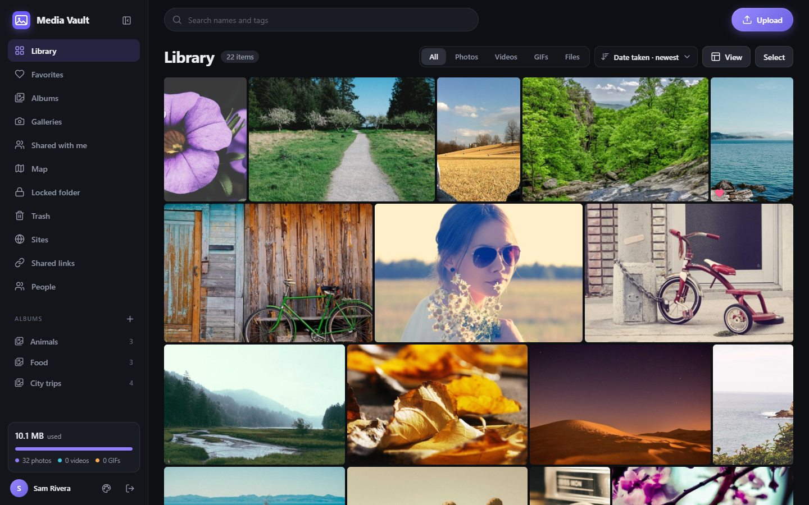
  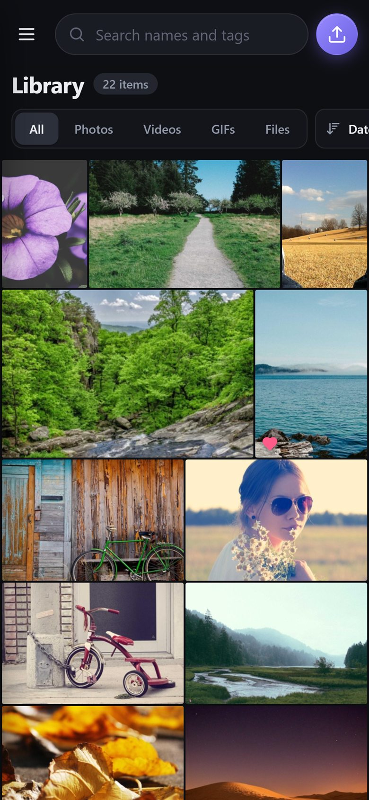

## Screenshots

  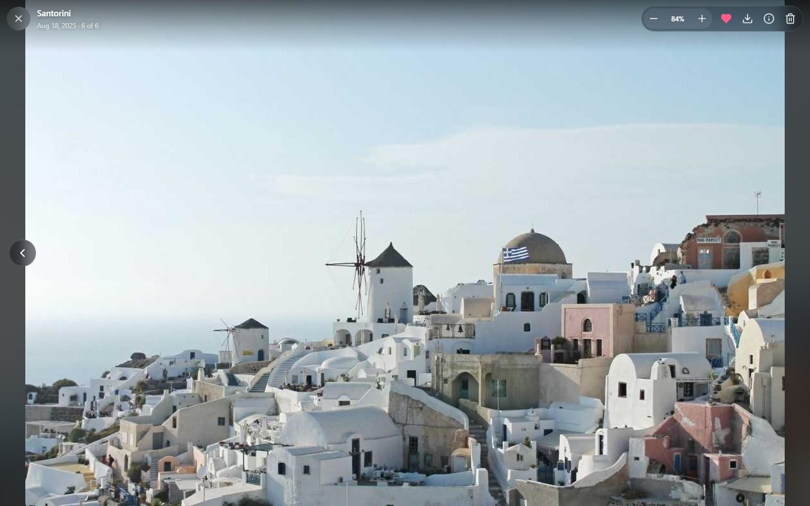
  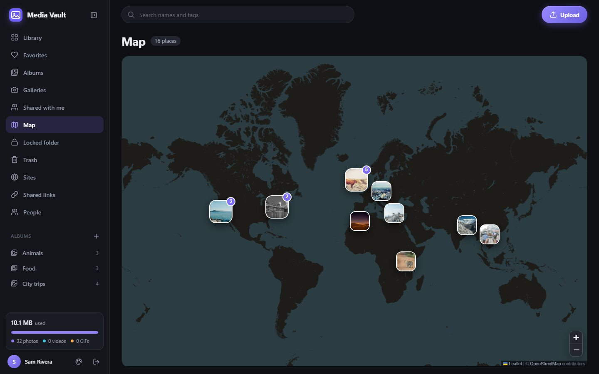

  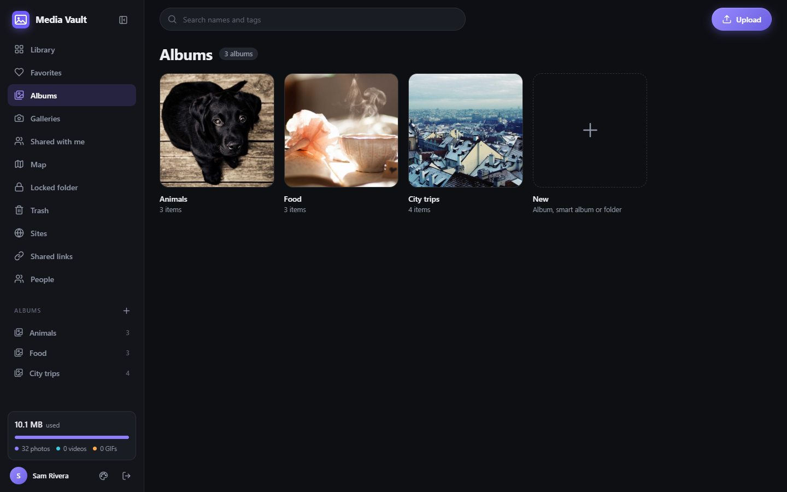
  

  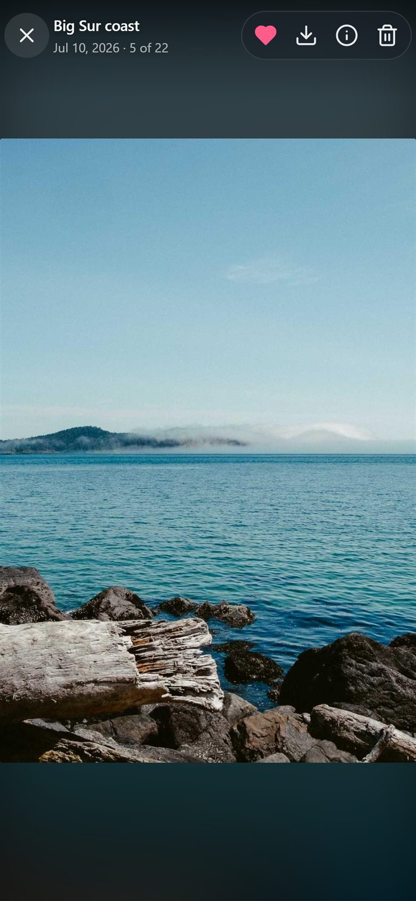
  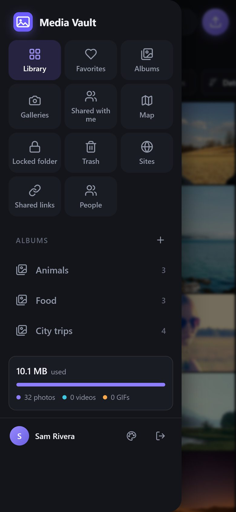
  

*Sample photos from [Unsplash](https://unsplash.com) via [Lorem Picsum](https://picsum.photos).*

## What your PC needs

Windows 10 or 11 (64-bit) and this folder - that's all. **No Node.js, npm, Python, Docker, Git or Linux terminal
(WSL)**, and nothing to build: the scripts are PowerShell, which comes with Windows. PocketBase is included (setup
only downloads it, about 13 MB, if it's missing). Only building the Android app (Java JDK 17 + Android SDK) or a new
installer (Inno Setup) needs extra tools. Details: part 1 of `docs\SETUP-GUIDE.md`.

## Getting started

The step-by-step version, with screenshots of every setup page (Tailscale, phones, sites with their own backend,
building the Android app and its signing key): **`docs\SETUP-GUIDE.md`**.

1. Run **`Media-Vault-Setup-{version}.exe`** (if Windows says "Windows protected your PC", press **More info** >
   **Run anyway**). It installs to `C:\Media Vault` without admin rights and opens setup when it's done.
   *Or with the zip:* right-click it > **Properties** > tick **Unblock** > **OK**, unzip it somewhere that is **not**
   synced by OneDrive (e.g. `C:\Media Vault`) and double-click **`start.bat`**.
2. The first time, Media Vault opens **setup**:
   - press **Next** through the pages - the defaults are fine for almost everyone;
   - enter your email and a password when asked - that's your Media Vault account (the owner) and the admin
     dashboard's, so you only need one;
   - press **Set up** at the end. Windows asks once for admin rights (for the firewall).
3. Your browser opens Media Vault - **sign in** with that email and password. Invite other people from the app's
   menu ("Invite people").
4. On your phone: press **Connect a phone...** in the Media Vault window and scan the QR code with the camera.

From then on, `start.bat` (or the desktop shortcut) starts Media Vault and opens its status window, which shows
whether it's running and the addresses to use.

## Using it from your phone

- **Easiest:** **Connect a phone...** on the status window's Status page shows a QR code - scan it with the camera.
- **At home:** open the "Home Wi-Fi" address shown in the status window (like `http://192.168.1.20:8091`).
- **Anywhere:** install [Tailscale](https://tailscale.com/download) on the PC and the phone, sign in to both with the
  same account, and run setup again (`setup.bat`) - it adds a private `https://` address that only your devices can
  open.
- **Android app:** see below.

## Android app

**Where to get it** (it's the same app everywhere - `media-vault.apk`):

- **From GitHub:** the [latest release](../../releases/latest) - under **Assets**, tap **media-vault.apk**.
- **From your own Media Vault:** it comes with Media Vault (`pb_public\downloads\media-vault.apk`), so your PC hands
  it out too: **Connect a phone...** in the status window (or setup's last page) has an **Android app - download** QR code, or
  open `{your Media Vault address}/downloads/media-vault.apk` in the phone's browser.

  
  

**Installing it** (Android 8 or newer):

1. Download `media-vault.apk` on the phone and tap it (or open it from **Downloads**).
2. If Android says it can't install apps from this source, tap **Settings**, turn on **Allow from this source** for
   your browser, then go back and tap **Install**. If Play Protect warns about an unknown app, tap **More details** >
   **Install anyway** - the app isn't on the Play Store, so it doesn't know it.
3. Open **Media Vault**. It asks for your server address - the one shown in the status window or on setup's last
   page: `https://{pc}.{tailnet}.ts.net:8443` over Tailscale (works anywhere) or `http://{PC's Wi-Fi address}:8091`
   (at home only). Then sign in with your Media Vault email and password.
4. Allow access to photos and videos when it asks, so you can upload, and photo locations, so your photos keep where
   they were taken.

**Updating:** install the new `media-vault.apk` over the old one - your sign-in stays. If Android says the app
"conflicts with an existing package" (installs from before October 2026 used another signing key), uninstall
Media Vault from the phone first, then install. Your photos are on the PC, so nothing is lost.

Building it yourself: `android\README.md`.

## Client galleries (for photographers)

**Galleries** in the sidebar: send a client a private gallery link - your studio name, a cover and a message - where
they view, heart their favorites and download (web size or full resolution, one photo or all as a .zip), with no
account or Tailscale. You see views, downloads and their favorites. Step by step: "Client galleries" in part 5 of
`docs\SETUP-GUIDE.md`.

## Hosting sites (web pages, games, portfolios)

**Sites** in the sidebar (owner only) puts your own web projects online from the same PC - anything that's a folder
of files with an `index.html`: a portfolio, a small web game, a page for an event, a built React/Vue/Svelte app.

  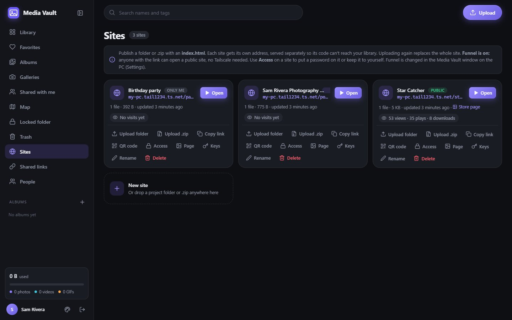
  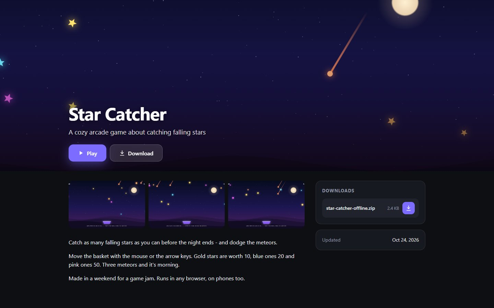

- **Publish:** **New site**, give it a name and an address (e.g. `my-game`), then **Upload folder** or
  **Upload .zip** - or just drop the folder or .zip on the page. A wrapping folder, hidden files and `node_modules`
  are skipped, and if the project has a built `dist\` or `build\` folder Media Vault offers to publish that. Uploading
  again replaces the whole site.
- **Its address:** `https://{pc}.{tailnet}.ts.net/my-game/` once Tailscale is set up, or `http://{PC}:8092/my-game/`
  at home. Sites run on a separate server from your library, so a site's code can never reach your photos or your
  sign-in.
- **Who can open it (Access):** **Public** (anyone with the link), **Password** (visitors type it once; their device
  remembers it for 30 days) or **Only me**. "Public" means public on the internet only if you turn on Tailscale Funnel
  for them (Media Vault window > **Settings** > **Hosted sites**) - otherwise it's only your own devices on Tailscale.
- **Share it:** **Copy link**, or **QR code** for a code people can scan (with **Save picture** for a poster).
- **Store page (Page):** an itch.io-style page shown before the site - cover picture, tagline, description, up to 8
  screenshots and up to 10 downloads (a build, an APK, a .zip). Visitors press **Play** to open the site full screen.
- **Keys:** personal links that let one person in past the password or **Only me**, or get the downloads when those
  need a key. Each key works on 1 device (or 3, or any number), can expire after 7 or 30 days, and stops working when
  you delete it.
- **Visits:** each site card shows its views, plays and downloads; click that line for this week and today.

  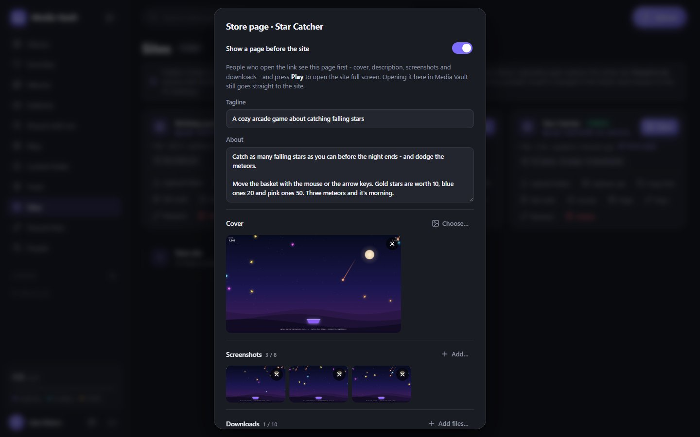
  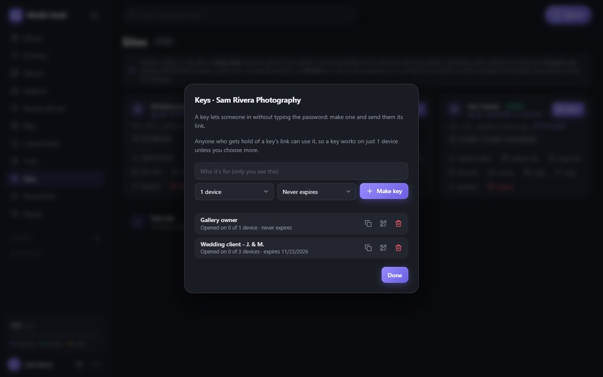
  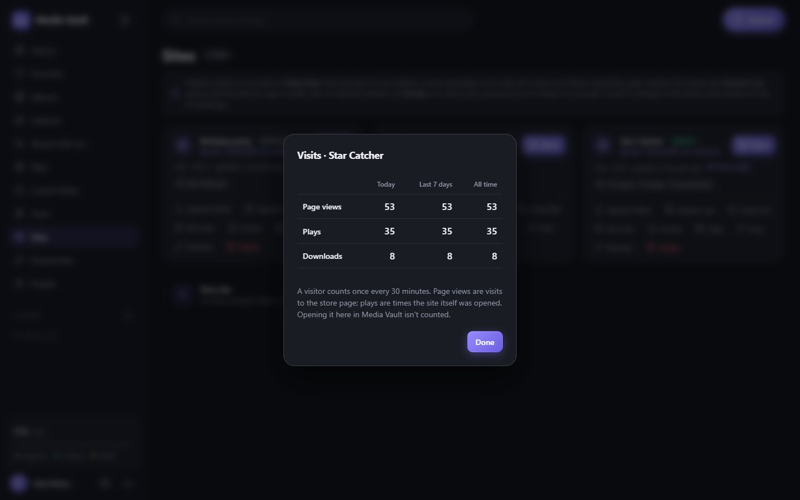

- **Sites with a backend** (e.g. a game that saves players' progress on a server): **Settings** > **Add a site or
  backend...** in the Media Vault window sets up the site and its own PocketBase server in one go.

Every published site is also copied to the `projects\` folder, so all your sites are in one place to keep or back up.
Step by step, with screenshots: part 6 of `docs\SETUP-GUIDE.md`.

## Changing things later

Run **`setup.bat`** (or **Setup...** in the status window): where your library is stored (e.g. a bigger drive -
setup moves it), ports, admin account, Tailscale addresses, hosted-site servers, firewall, starting with Windows. It
keeps your library and only changes what you change.

## Backups

Everything you upload is in the library folder - `pb_data`, unless you chose another place in setup (the status window shows it under **Storage**; hosted sites: `pb_sites\www`). To back up, stop Media Vault
(close its window and choose Yes) and copy those folders somewhere safe.

## For developers

Moving an install to another PC, the https layout and making a clean copy
(`scripts\make-package.ps1`): `docs\MOVING.md`. Building the installer: `scripts\make-installer.ps1` (Inno Setup,
`installer\MediaVault.iss`). The Android app: `android\README.md`.

## License

MIT - see `LICENSE`. PocketBase (`pocketbase.exe`, which setup downloads) and the bundled libraries keep their own
licenses, listed at the end of `LICENSE`.
