# Media Vault - full setup guide

This walks through everything from a fresh copy to phones connected: the PC, Tailscale, setup, your account, hosted
sites with their own servers (like a game's save server), and the Android app, including **where the app-signing key
is needed** (part 7).

---

## 1. What you need

### What the PC needs

Media Vault is made to be simple to run: **a Windows PC and this folder are all it takes.** Everything else it uses
is already part of Windows.

| | |
|---|---|
| **Windows 10 or 11** (64-bit) | Home or Pro. It's Windows only - the setup and status windows are Windows programs (on a Mac or Linux PC, use another way to run PocketBase). |
| **A PC that stays on** | Phones reach the library through it; when it's off or asleep, they can't. A desktop, or a laptop that's plugged in, both work. |
| **Disk space** | About 50 MB for Media Vault itself, plus room for everything people upload. The library can be on a different drive from Media Vault (part 3, step 2). |
| **Internet** | Not needed to install: the installer and the zip already include `pocketbase.exe` (setup only downloads it, about 13 MB, if it's missing from the folder). Media Vault then works on your home network without the internet; Tailscale (optional) needs it. |
| **Admin rights, once** | Windows asks one time, to let phones through the firewall. Media Vault itself runs as you, not as admin. |
| **A web browser** | Any recent one (Edge, Chrome, Firefox, Safari) - on the PC and on phones. |

**Not needed:** Node.js, npm, Python, Docker, a Linux terminal or WSL, Git, a database server, a web server, or a
build step. There's nothing to install or compile - double-click `start.bat`. The scripts behind it are PowerShell,
which comes with Windows, and they start themselves the right way (you don't have to change PowerShell settings).

### What you need for each part

| | Needed for | Notes |
|---|---|---|
| This folder | Everything | Put it **outside OneDrive** (e.g. `C:\Media Vault`): OneDrive syncing a live database can corrupt it. |
| An email address + password | Your Media Vault account | Asked once in setup ("Your account"): you sign in to Media Vault with it on any device, and it's also the admin dashboard's (`/_/`, on the PC only). Any email - nothing is sent to it. |
| [Tailscale](https://tailscale.com/download) (free) | Using it away from home, `https://` addresses, public sites | Optional. Without it, Media Vault works on your home Wi-Fi only. |
| JDK 17 + Android SDK + a signing key | Building the Android app | Optional - and the only part that needs developer tools. Phones can use the browser instead. See part 7. |
| [Inno Setup 6](https://jrsoftware.org/isinfo.php) (free) | Building the installer `.exe` yourself | Optional - only to make a new installer (`scripts\make-installer.ps1`); installing Media Vault doesn't need it. One command: `winget install --id JRSoftware.InnoSetup --scope user`. See part 8. |

What's in the folder:

| | |
|---|---|
| `start.bat` | Starts Media Vault and opens its window (setup the first time). **This is the one you use.** |
| `setup.bat` | Opens setup again, to change ports, Tailscale, startup... |
| `allow-firewall.bat` | Lets phones on your Wi-Fi connect (setup does this for you). |
| `start-console.bat` | For troubleshooting: runs the servers in a plain console window. |
| `projects\` | Optional: your sites that have their own backend, one folder each (part 6). |
| `docs\` | This guide and `MOVING.md`. |
| `scripts\` | The programs behind the .bat files - no need to open them. |
| `pb_data\`, `pb_sites\` | Your library and hosted sites (made when Media Vault first runs) - back these up. The library can live somewhere else instead (part 3, step 2). |
| `logs\` | What each server printed - the window's **Logs** page shows them. |

---

## 2. Tailscale (optional, do this first if you want it)

1. Install Tailscale on the PC and sign in. Install it on your phone(s) too and sign in with the **same account**.
2. In the Tailscale admin console (<https://login.tailscale.com/admin/dns>) turn on **MagicDNS** and
   **HTTPS Certificates**. (If you skip this, setup opens the page for you when it needs it.)
3. Only if you want hosted sites to be **public** (anyone with the link): Funnel has to be allowed for your tailnet.
   Setup opens the page to allow it the first time you pick "Public".

Skipping Tailscale is fine - run setup again later (`setup.bat`) to add it.

---

## 3. Run setup

### Install it

**The easy way - the installer** (`Media-Vault-Setup-{version}.exe`). Double-click it. Windows may first say
**"Windows protected your PC"**, because the installer isn't signed: press **More info** > **Run anyway**. It doesn't
need admin rights. There are three pages:

1. **Welcome** - press **Next**.

   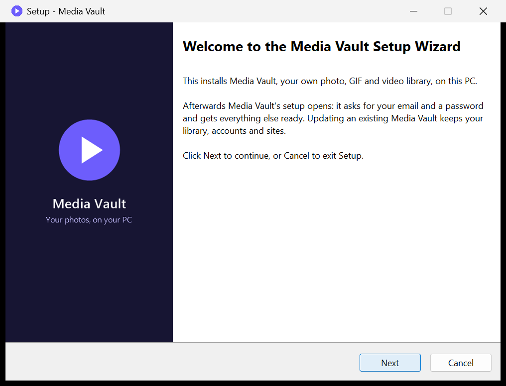

2. **Where to install it** - `C:\Media Vault` is a good place (not a OneDrive folder). Media Vault keeps its library
   in this folder too unless you pick another place in its setup. Press **Next** - it installs.

   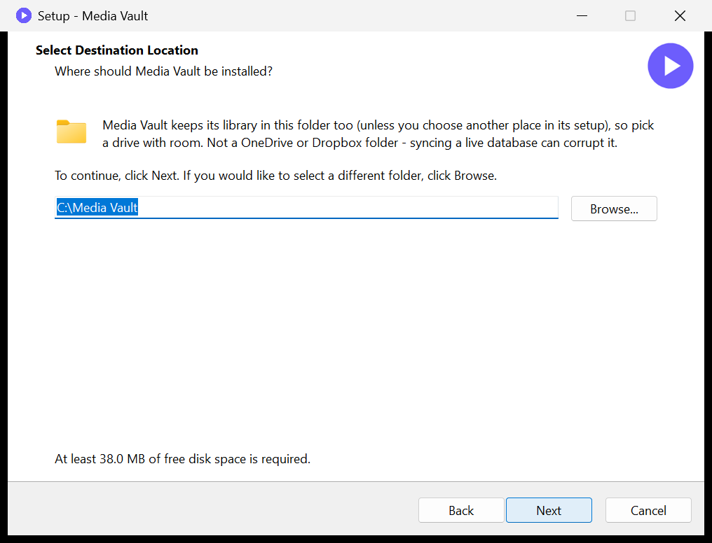

3. **Done** - leave **Set up Media Vault now** ticked and press **Finish**. Media Vault's setup opens; carry on below
   from step 1.

   

The installer adds **Media Vault** and **Media Vault setup** to the Start menu. Running a newer installer on a PC that
has Media Vault updates it: it closes Media Vault, replaces the program and keeps your library, accounts, settings,
sites and projects. To remove it: **Settings > Apps > Installed apps > Media Vault > Uninstall**. It stops Media Vault and
removes the program, its shortcuts, its Tailscale addresses (only Media Vault's - anything else on your Tailscale stays)
and its firewall rules - Windows asks once for admin rights for those; if you say No, the closing message says how to
remove them yourself. Your library and settings stay in the folder (delete it yourself if you don't need them, after
a backup).

**Or the zip.** Before unzipping it, right-click the zip > **Properties**, tick **Unblock** at the bottom (if it's there)
and press **OK**. Otherwise Windows treats every file as "from the internet" and may stop to ask about them. If you've
unzipped it already, that's fine too: when Windows shows **"Windows protected your PC"** for `start.bat`, press **More
info** > **Run anyway**, or for "Do you want to run this file?" press **Run**. It only asks once - Media Vault then
clears the mark from its own files. Then double-click **`start.bat`** in the main folder.

### Setup

When it's installed (or unzipped), Media Vault's setup opens - or double-click **`start.bat`** in the main folder. On a fresh copy it opens **Media Vault setup** (later you can open it
with `setup.bat` or the **Setup...** button in the Media Vault window). The steps are listed on the left; press
**Next** on each page. **Nothing changes until you press Set up on the Review page**, and **Cancel** leaves everything
as it was.

**Step 1 - Welcome.** Checks the folder, `pocketbase.exe`, existing data and Tailscale. Green is good; fix anything
red, then **Next**. ("Library: none yet" is normal on a new install.)

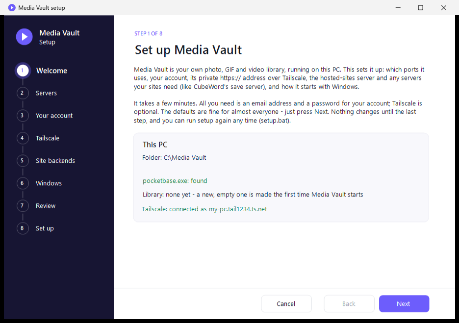

**Step 2 - Servers and where the library is stored.** Leave the ports (8091 for Media Vault, 8092 for the sites
server) as they are unless one says "in use" - then setup suggests a free one.

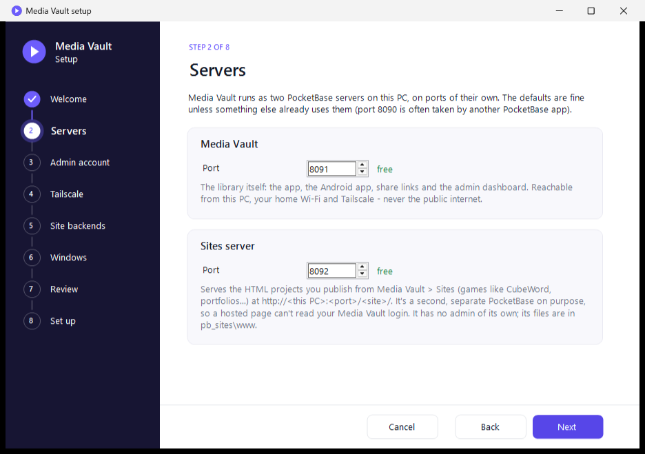

Scroll down to **Where your library is stored**. This is the folder that holds everything people upload - photos,
videos, files, accounts and the locked folder. The default (`pb_data` in Media Vault's folder) is fine if that drive
has room. To keep it somewhere else - a bigger drive, for example - press **Change...** and pick (or make, with
**Make New Folder**) an empty folder such as `D:\Media Vault library`. If you pick a folder that already has other
things in it, setup makes a `Media Vault library` folder inside it. **Use the default** goes back to `pb_data`.

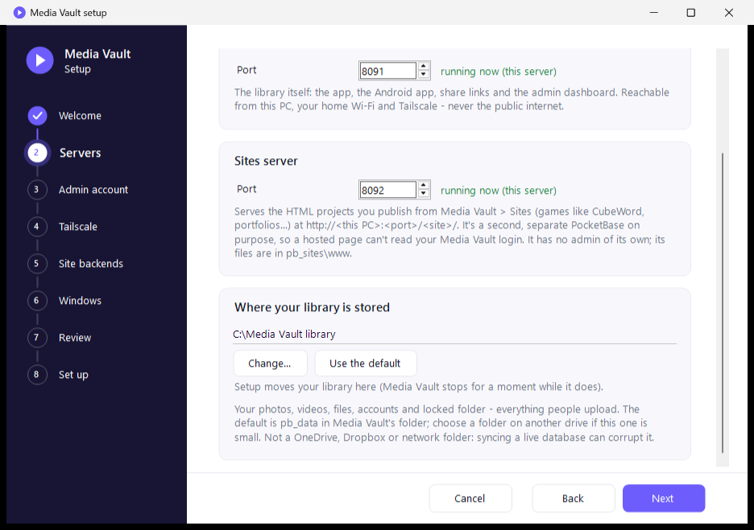

The line under the buttons says what will happen. Setup refuses folders that would cause trouble: network drives and
shares, folders synced by OneDrive, Dropbox or Google Drive, folders inside Media Vault's own folder (other than
`pb_data`), and a drive without room for your library.

**Step 3 - Your account.** Enter your email and a password (10+ characters), twice. Write it down. This one login is
used for both:
- **your Media Vault account** - the owner, who invites other people and manages storage and Sites. You sign in with
  it on the PC, phones and anywhere else;
- **the admin dashboard** (PocketBase's back office), which only opens on this PC.

Setup creates both, so there's nothing to set up in the browser afterwards. (Running setup again later shows **Keep the
accounts as they are**, or a new dashboard password. A password you change in the app later changes only your Media
Vault sign-in.)

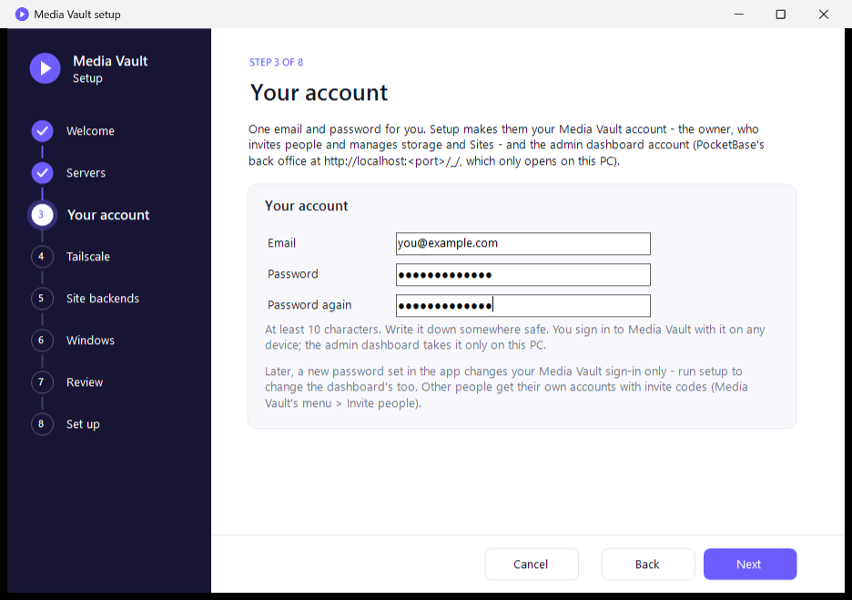

**Step 4 - Tailscale.** If it says "Connected as ...", choose:
- **Media Vault's https:// address: On** (recommended - your devices on Tailscale only, never public);
- **Hosted sites: Tailnet only**, or **Public** if you want sites anyone can open.

If Tailscale isn't installed or connected, this page just says so - skip it and come back later.

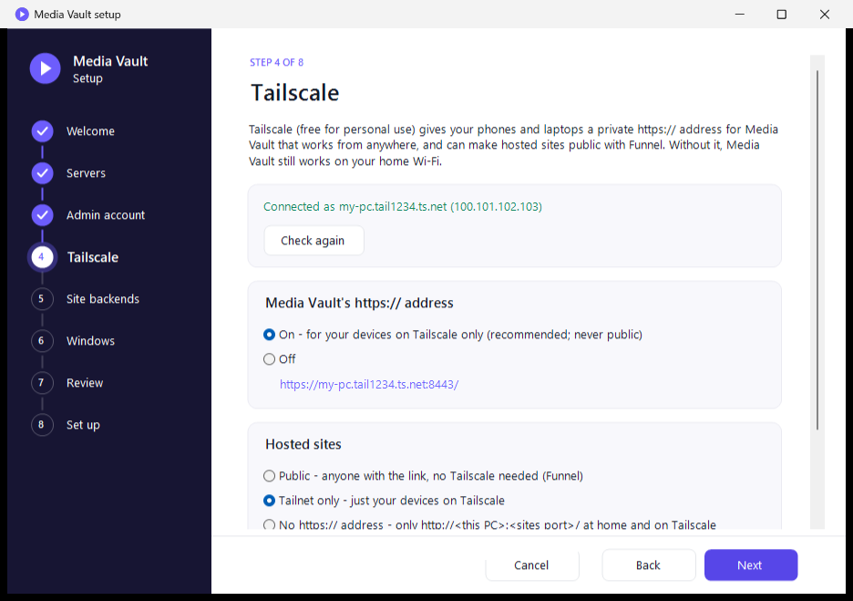

**Step 5 - Site backends.** Leave the list empty for now. Sites that need their own server (like a game's save
server) are easier to add afterwards from the Media Vault window - see part 6.

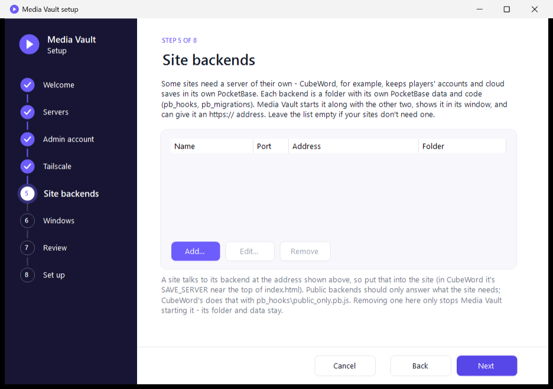

**Step 6 - Windows.** Keep all the boxes ticked: the firewall rule (so phones on your Wi-Fi can connect), start with
Windows, a desktop shortcut, and start Media Vault when setup is done.

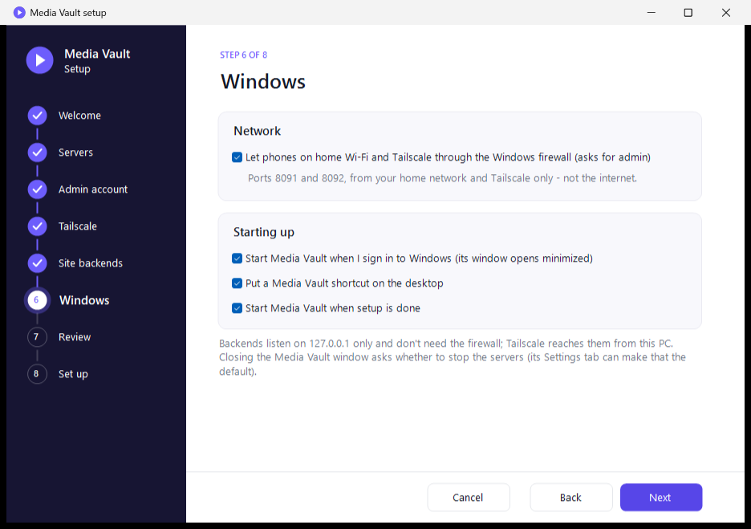

**Step 7 - Review.** Check the list and press **Set up**. Windows asks once for admin rights (for the firewall) - say
**Yes**.

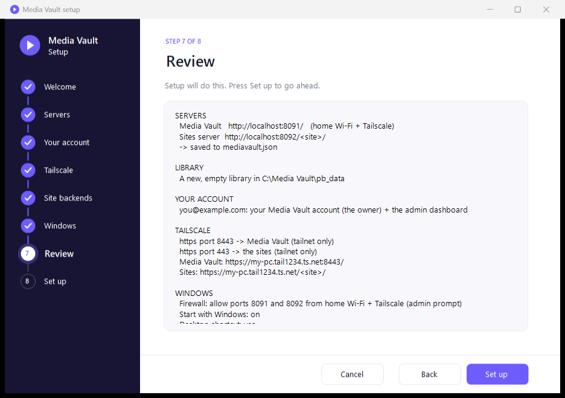

**Step 8 - Set up.** Shows each step as it runs, creates your account, starts Media Vault and opens it in your
browser - sign in with the email and password from step 3. The last part, **HOW TO OPEN MEDIA VAULT**, lists your
addresses, and **Connect a phone (QR code)...** shows a code to scan with your phone (part 5).

If a step says FAIL or WAIT, fix what it says (e.g. allow HTTPS in Tailscale) and run `setup.bat` again - it only
redoes what's needed. Its log is `logs\setup.log`.

### Moving the library later (e.g. to a bigger drive)

Run `setup.bat` (or **Setup...** in the Media Vault window), go to **Servers**, press **Change...** next to **Where
your library is stored** and pick an empty folder. Press **Next** to the **Review** page - it shows where the library
moves from and to - and press **Set up**.

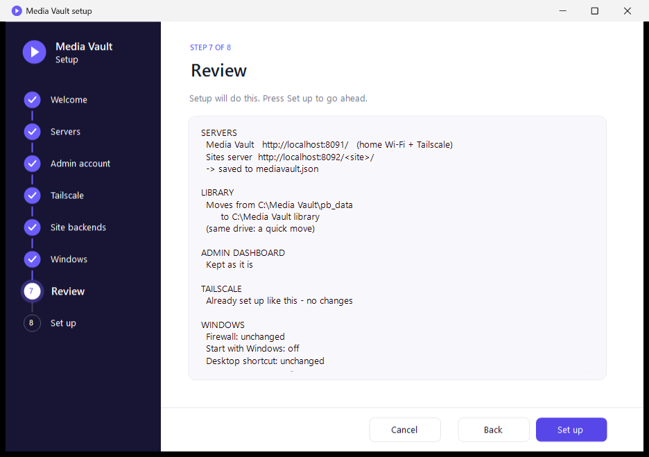

Setup stops Media Vault, moves the library and starts it again. Nothing in the library changes - accounts, albums,
share links and the locked folder all keep working.
- **Same drive:** it's moved in a moment.
- **Another drive:** it's copied (this can take a while for a big library), the copy is checked file by file, and
  the old folder is kept, with `-old-{date}` added to its name. Once Media Vault works from the new place, delete the old
  folder to get the space back. If anything goes wrong, the library stays where it was.

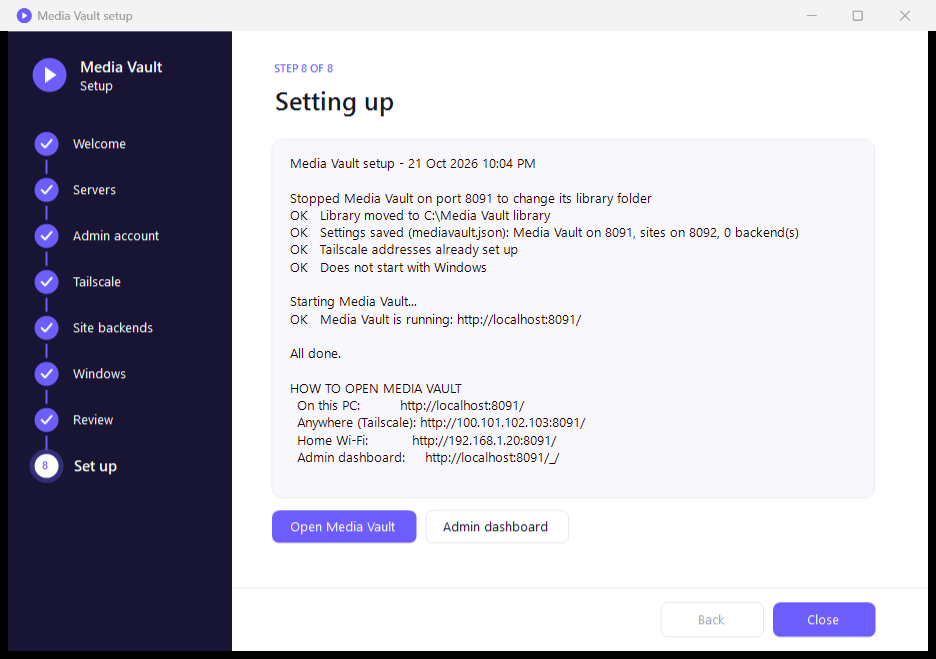

Afterwards the Media Vault window's Status page shows the new place under **Storage > Library folder** (click it to
open the folder). Keep the drive connected: if it's missing, Media Vault can't start.

### The Media Vault window

After setup, `start.bat` (or the desktop shortcut) opens this window. It starts the servers and shows whether they
are running, the addresses to use (click one to open it, right-click to copy) and how much space the library uses.
**Settings** (left) has Tailscale, startup, the firewall and sites with a backend; **Logs** shows what each server
printed. Closing the window asks whether to stop the servers.

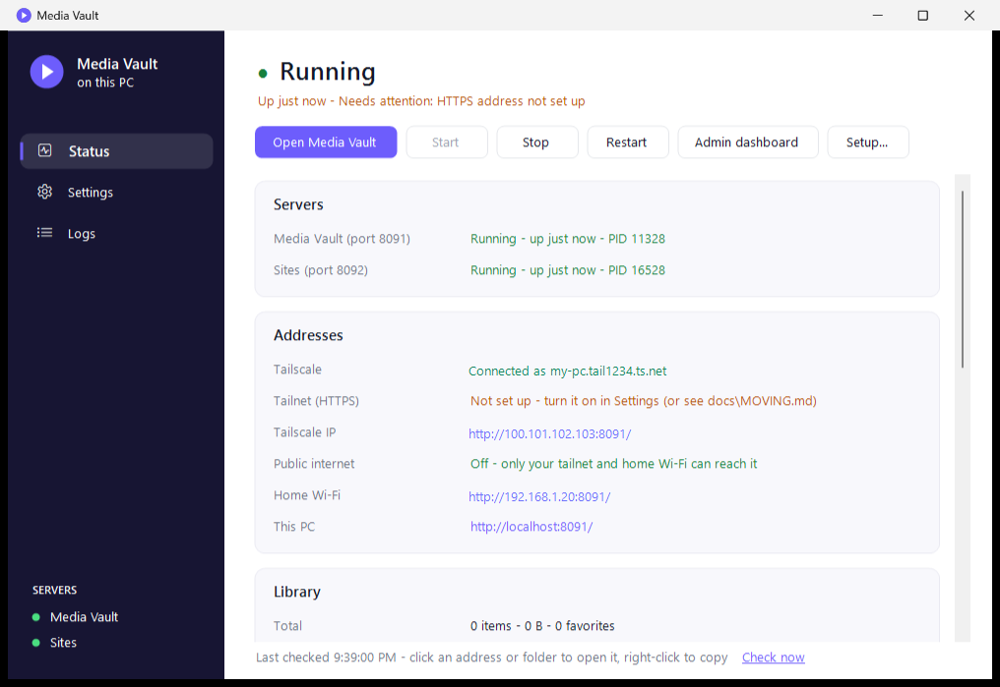

---

## 4. Sign in

Your browser opens Media Vault (or go to `http://localhost:8091`). **Sign in with the email and password from setup** -
setup already made that account, and it's the owner. The owner can:
- invite people: menu > **Invite people** (each new person needs an invite code; you can give them a storage limit),
- turn on regular files (PDFs, zips...) per person under **People**,
- host web pages under **Sites**.

(If setup couldn't create the account - its last page says FAIL - Media Vault asks you to create one instead; the
first account becomes the owner.)

The admin dashboard (`http://localhost:8091/_/`, the same email and password) shows every record; you rarely need it.
It only opens on the Media Vault PC itself: from phones, other computers or Tailscale it isn't there, and its account
can't sign in.

---

## 5. Phones and other computers

**The easy way - scan a QR code.** In the Media Vault window, the **Status** page has a **Phones** card: press
**Connect a phone...** (setup's last page has the same button).

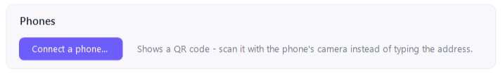

Open the phone's camera, point it at the code and tap the link that appears. Use the list to pick the address:
- **anywhere (Tailscale)** - works away from home; the phone needs the Tailscale app on, signed in to your account;
- **home Wi-Fi** - works when the phone is on the same Wi-Fi as the PC;
- **Android app - download** - only when the app has been built and put in `pb_public\downloads\` (part 7).

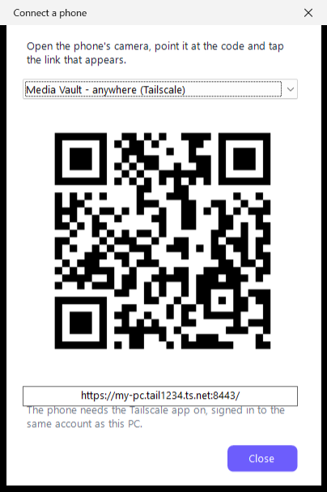

Sign in, and to make it feel like an app: browser menu > **Add to Home screen**. Or use the Android app (part 7).

**Sharing photos with a QR code.** When you share an album or photos as a link (select them > **Share**), the
**Link ready** window has a **QR code** button, and every link in the menu's **Shared links** has a QR icon. The
code opens the same link - point a phone's camera at it, or press **Save picture** (a PNG with the title and link
under it) or **Share…** on a phone. The window also says who can open it (your Tailscale, or anyone for a public
link), its password if it has one, and when a link has expired.

**Typing it instead:** the addresses are on setup's last page and the Status page:
- **At home:** `http://<PC's Wi-Fi address>:8091` (like `http://192.168.1.20:8091`).
- **Anywhere, with Tailscale on the phone:** `https://<pc-name>.<tailnet>.ts.net:8443`.

### Client galleries (for photographers)

A **gallery** is a private page on the internet for one client: your photos under your studio name, with a cover
photo and a welcome message. The client opens the link on any phone or computer - **no account, no app and no
Tailscale** - looks through the photos, hearts their favorites and downloads them. You see how often it was opened,
how many photos were downloaded, and every client's favorites.

**Once: put the sites on the internet.** Galleries go out through the sites' public address (Tailscale Funnel, like
public links). In the Media Vault window on the PC: **Settings > Hosted sites > Public**. (The Galleries page says so
if it's off.) Only Media Vault's sites and galleries are reachable that way - never your library or your login.

**Make a gallery:**
1. Put the photos in an album - or select them in your library.
2. In the album, press **Client gallery** at the top - or, with photos selected, **Gallery** in the bar. (Or open
   **Galleries** in the sidebar > **New gallery** and pick an album.)
3. Fill in the window: a **title** (e.g. "Anna & Ben's wedding"), a **welcome message**, how long it stays open
   (**7, 30, 60 or 90 days** - extend it later), an optional **password**, and whether clients may **download** and
   **heart favorites**.
4. Press **Create gallery**. The next window has the link to send, **Copy**, **Send…** and a **QR code**.

**On the Galleries page** each gallery has a card with its cover, whether it's open, the counts (views, downloads,
favorites), and **Open**, **Copy link**, **QR code**, **Favorites**, **Edit** and **Delete**. Set your **studio name**
at the top once - it's shown on every gallery. **Edit** changes the title, message, end date (up to 90 days from
today), password, downloads and favorites, and lets you choose the **cover photo**.

**What the client sees:** the cover with your studio name, the title and your message, then the photos.
- **Hearts:** tapping one asks their name once (so you know whose picks they are); **Favorites** shows just those.
  They come back if the client opens the link again on the same phone or computer.
- **Downloads:** one photo from the viewer, or **Download all** as a single .zip - all photos or only their
  favorites, at **web size** (up to 2048 px, small, for phones and social media) or **full resolution** (the
  originals). In Chrome and Edge on a computer the .zip goes straight to disk, so even a very big gallery works; on a
  phone, very large downloads may not finish - favorites or web size are better there.
- Photos are shown at web size, so the gallery is quick on a phone. Web-size copies are made in the background: a
  big gallery can take a few minutes (the card says how many are left), and until then those photos open as the
  original.

**Your clients' favorites:** **Favorites** on a gallery's card shows each person's picks (they arrive within a
minute). **Copy file names** copies the list of original file names - paste it into Lightroom's filter, for example,
to find the RAW files - and **Make an album** puts their picks into a new album in your library.

Counts include every opening of the link, your own too. Deleting a gallery stops the link at once and drops its
favorites; your photos stay in your library.

---

## 6. Hosted sites and site backends (e.g. a game with accounts and cloud saves)

**Sites** (owner only, in the app): upload a folder or .zip of a static web project; it's served by the separate
sites server at `https://<pc>.<tailnet>.ts.net/<site>/` (or `http://<PC>:8092/<site>/`). Each site has its own
access setting: public, password, or private.

**Sharing a site:** each site has **Copy link** and **QR code**. The QR code opens a window with the code, the
link and who can open it; point a phone's camera at it, or press **Save picture** (a PNG with the site's name and
link under the code, for a poster or a chat) or **Share…** on a phone. It's the site's normal link, so a site set to
**Password** still asks for its password and one set to **Only me** stays closed to others. Open Media Vault from its
Tailscale or home Wi-Fi address to make the code: on the PC itself the link is `localhost`, which phones can't open
(the window warns about that).

**Every site you publish is also copied to the `projects\` folder** - from the app's Sites page or from the Media
Vault window - so all your sites are in one place on the PC, to keep, back up or edit. The copy is
`projects\<site address>\` (for example `projects\cubeword\`) and is replaced each time you publish that site again,
so keep your own notes and edits in the original project. Things to know:
- Editing files in the copy doesn't change the live site - upload or add it again to publish the change.
- You can rename the copy's folder; Media Vault still finds it (it recognises its own copies by a small hidden file,
  `.mediavault-site.json`).
- If `projects\` already has a folder with that name that isn't Media Vault's copy (for example your own project with
  its backend), it's never touched - the copy goes next to it as `projects\<site address>-site\`.
- A project you add from inside `projects\` isn't copied again - it's already there.
- Deleting a site leaves its copy in `projects\`; delete that folder yourself if you don't want it.

**Site backends** are for sites that need a server of their own - CubeWord, for example, keeps player accounts and
cloud saves in its own PocketBase. Media Vault must be running (press **Start** in its window if it isn't).

**Step 1 - Put the project in one folder.** The site and its backend go together in one folder per project, for
example:

    projects\
      cubeword\
        index.html        <- the site (or in dist\, build\, public\ ...)
        server\           <- its backend: pb_hooks\, pb_migrations\ (and pb_data\ to keep existing players' data)

The best place is Media Vault's own **`projects\`** folder (in the main folder; **Settings > Open the projects
folder** opens it), which keeps everything together and backs up with it. This is optional: a project can stay
anywhere on the PC, and step 4 can move it into `projects\` for you. (A copy made with `scripts\make-package.ps1`
already has its backends under `backends\` - setup offers those itself.)

**Step 2 - Open Settings > Sites with a backend.** In the Media Vault window, click **Settings** on the left and
scroll down to **Sites with a backend**.

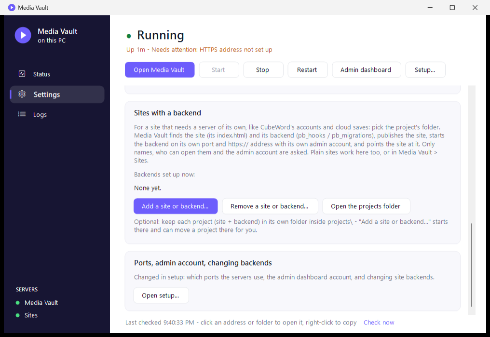

**Step 3 - Add a site or backend... and pick the folder.** The folder picker opens in `projects\`. Choose the
project's own folder (e.g. `projects\cubeword`, not `projects` itself) and press **OK**. Media Vault looks for the
site's `index.html` (at the top, or in `dist`, `build`, `public`, `pb_public`...) and the backend (`pb_hooks` /
`pb_migrations`, in the folder or one level down).

**Step 4 - Fill in the window.** Most of it is filled in already:

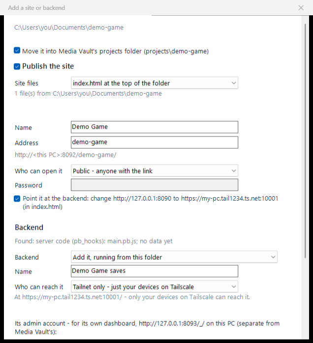

- The folder it found is at the top. If it's outside `projects\`, you can tick **Move it into Media Vault's projects
  folder** (only offered when nothing is running from it and it's on the same drive).
- **Publish the site**: the site's **name**, its **address** (the last part of the link, e.g. `/cubeword/`) and **who
  can open it** - *Public*, *Password* (visitors type it once) or *Only me*.
- **Point it at the backend**: leave this ticked. It changes the backend address the site's pages use (CubeWord's
  `SAVE_SERVER`) to the new one - only in the published copy; your project's files aren't changed.

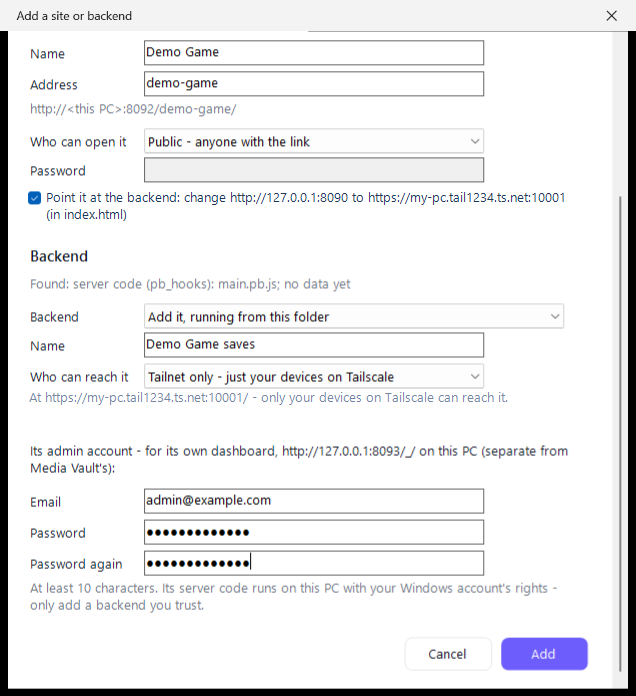

- **Backend**: *Add it, running from this folder* (normal). If a PocketBase is already running from that folder
  (e.g. from its own .bat), choose *Add a separate copy* instead - two servers on one database can damage it.
- Its **name** (shown in the Media Vault window) and **who can reach it**: *Public* for a game anyone can play,
  *Tailnet only* for just your devices, or *This PC only*.
- **Its admin account**: an email and a password (10+ characters) for the backend's own dashboard,
  `http://127.0.0.1:<port>/_/` on this PC. Separate from Media Vault's.

**Step 5 - Press Add.** Media Vault picks a free port and https port for the backend (10000 for a public one -
Funnel only allows 443, 8443 and 10000, and the first two are taken by the sites and Media Vault), adds its hooks,
starts it, sets up its address and publishes the site. A message shows the site's link, the backend's address and,
if the project wasn't in `projects\` already, where the copy of the site went (see above).
From then on the backend is listed under **Backends set up now** and starts and stops with Media Vault.

If the site's pages didn't name a backend address, the window says so - put the address it shows into the site and
add it again (picking the same address replaces the site's files). `setup.bat` > **Site backends** does the same with
every setting by hand, and is where you change a backend later.

To take one away again: **Settings** > **Remove a site or backend...**, tick it (a site and the backend it calls are
ticked together) and press **Remove**. The site and its hosted files are deleted; the backend is stopped, its https
address turned off and it's taken off the list. Its folder and data stay - except for a copy Media Vault made in
`backends\`, whose folder is deleted too if you tick that box. Your own project folder is never touched.

The Media Vault window then starts, watches and stops the backend along with everything else.

A backend's code runs with your Windows account's rights, so setup asks before keeping backends that came with a
packaged copy, and before running a backend's own `pocketbase.exe` if it isn't the build Media Vault downloads (if that
file changes later, it isn't started until you approve it again). A **Public** backend gets Media Vault's guard hook
(`pb_hooks\mediavault_guard.pb.js`): from the internet its admin dashboard and superuser sign-in don't work, so manage
it on this PC at `http://127.0.0.1:<port>/_/`. Any backend with an https address (public or tailnet) also gets flood protection (`pb_hooks\mediavault_flood.pb.js`): one visitor can make at most 300 requests per 10 seconds. Everything else is up to the backend's own API rules and hooks - give
every collection rules before making it public.

---

## 7. The Android app - and where the signing key is needed

The app is optional: it's the same Media Vault in a full-screen window, plus multi-file upload, downloads to
`Downloads/Media Vault/`, and full-screen video. This copy doesn't include a built app, so you build it once.

### Where the key is (and isn't) needed

| Task | Signing key needed? |
|---|---|
| Running Media Vault, setup, the web app, sites, backends | **No** |
| Using Media Vault in a phone browser | **No** |
| Building the Android app for phones (`gradlew assembleRelease`) | **Yes** - it signs the APK |
| Building **every later update** of the app | **Yes - the same key.** Android only installs an update over the app if it's signed with the same key; with a different key, people must uninstall first. |
| A quick test build (`gradlew assembleDebug`) | No (uses Android's debug key; fine for your own phone, not for sharing) |

The key is two files in the `android\` folder (both are ignored by git and never packaged by `scripts\make-package.ps1`):
- `android\media-vault.jks` - the key itself
- `android\keystore.properties` - its passwords, read by `android\app\build.gradle`

**Keep both private and backed up** (e.g. a password manager or an offline USB stick). Never put them in
`pb_public\` (that folder is served to browsers) or share them with the folder. Losing them means future app versions
need an uninstall/reinstall on every phone (the library itself is safe - it lives on the PC).

### Build steps (one time setup)

1. Install **JDK 17** (e.g. Eclipse Temurin 17) and the **Android SDK** (easiest: install Android Studio, open it once
   so it downloads the SDK).
2. Create `android\local.properties` with the SDK location, e.g.
   `sdk.dir=C\:/Users/<you>/AppData/Local/Android/Sdk`
3. Make your signing key (once - then reuse it forever). In a command prompt in the `android` folder:

       "C:\Program Files\Eclipse Adoptium\jdk-17...\bin\keytool.exe" -genkeypair -v -keystore media-vault.jks -alias media-vault -keyalg RSA -keysize 2048 -validity 10000

   It asks for a password and a name; for the name you can just enter `Media Vault` (whatever you type is readable
   by anyone who has the APK, so don't use personal details).
4. Create `android\keystore.properties`:

       storeFile=media-vault.jks
       storePassword=<the password you chose>
       keyAlias=media-vault
       keyPassword=<the same password>

### Build and publish the app

    cd android
    set JAVA_HOME=C:\Program Files\Eclipse Adoptium\jdk-17...
    gradlew.bat assembleRelease
    copy app\build\outputs\apk\release\app-release.apk ..\pb_public\downloads\media-vault.apk

For an update: raise `versionCode` (and `versionName`) in `android\app\build.gradle`, build again with the **same**
key, copy over the old APK.

### Install it on a phone

1. On the phone, open `<your Media Vault address>/downloads/media-vault.apk` (setup's last page shows the exact link
   once the APK is in `pb_public\downloads\`).
2. Allow "install unknown apps" for the browser when Android asks, then install.
3. When the app asks for the **server address**, enter the address from setup's last page
   (`https://<pc>.<tailnet>.ts.net:8443` with Tailscale, or `http://<PC's Wi-Fi address>:8091` at home).
   It can be changed later from the "Can't reach Media Vault" screen > **Change address**.

---

## 8. Every day, backups and moving

- **Start/stop:** the desktop shortcut or `start.bat` opens the Media Vault window (Start / Stop / Restart, addresses,
  library size, logs). Closing it asks whether to stop the servers.
- **Backups:** stop Media Vault, then copy the library folder (`pb_data`, or the one chosen in setup - the Status
  page shows it under **Storage**) and `pb_sites\www` (hosted sites), plus any site backend's `pb_data`. Keep the
  Android key files backed up separately.
- **Moving to another PC:** copy the whole folder (while stopped) - and the library folder too, if it's somewhere
  else - then run `setup.bat` on the new PC and, on **Servers**, point **Where your library is stored** at the copied
  library (setup sees it's a library and uses it). Phones need the new address (app: **Change address**).
- **A clean copy for someone else:** `scripts\make-installer.ps1` makes `packages\Media-Vault-Setup-{date}.exe` - an
  installer without your library, settings, logs or key (needs Inno Setup on this PC, once:
  `winget install --id JRSoftware.InnoSetup --scope user`). `scripts\make-package.ps1` makes the same as a zip.

## 9. If something's wrong

| Problem | Fix |
|---|---|
| Phone can't connect at home | Run `setup.bat` and tick the firewall box (or `allow-firewall.bat`). PC and phone must be on the same Wi-Fi. |
| `https://` address doesn't work | Tailscale on in both PC and phone; HTTPS Certificates on in the Tailscale admin console; run `setup.bat` again. |
| "Port in use" | Another program uses it - pick the free port setup suggests. |
| Media Vault window says a server "Stopped unexpectedly" | Open its **Logs** tab and pick the server's "errors" log. |
| Forgot the admin dashboard password | Run `setup.bat` > Your account > set a new one. |
| Forgot your Media Vault password | Run `setup.bat` > Your account and set the dashboard account, then sign in to the dashboard (`http://localhost:8091/_/` on this PC) > **users** > your account > set a new password. |
| "Windows protected your PC" when opening `start.bat` | **More info** > **Run anyway** (it's because the zip came from the internet; it only asks once). Or unblock the zip before unzipping - see part 3. |
| A site backend says "No https address yet" | Run `setup.bat` and check its row on Site backends. |
